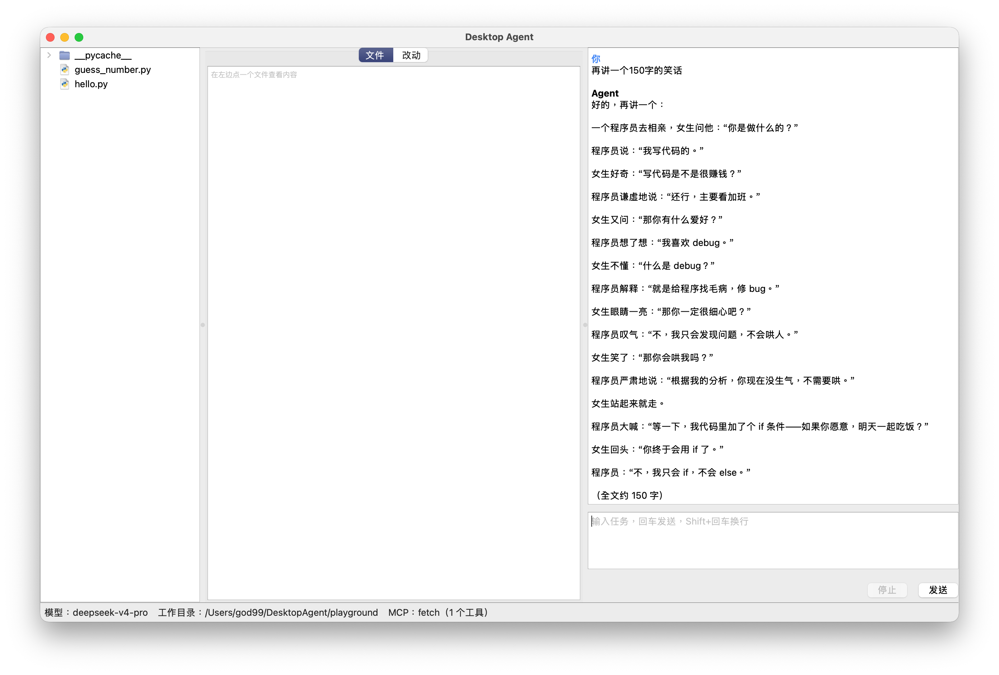
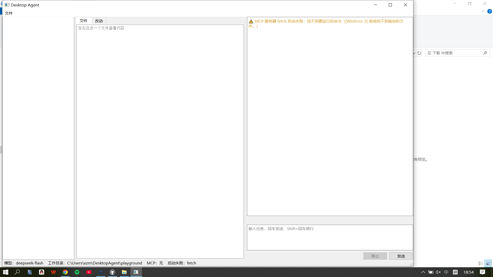
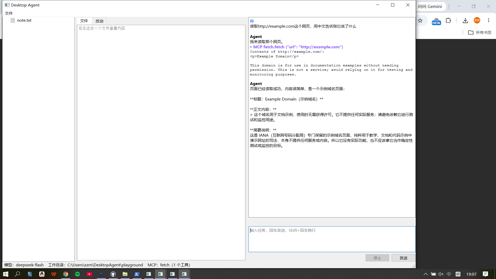

# Desktop Agent：桌面端 AI 编程助手

>姓名：项梦婷

一个用 Python 编写的桌面 AI 编程助手，类似 Cursor / Claude Desktop：用自然语言描述任务，它会自己读写文件、执行命令、调用 MCP 工具，一步步完成编程任务。



## 功能与作业要求对照

| 作业要求 | 实现方式 |
|---|---|
| 真正的桌面应用 | PySide6（Qt）原生窗口，不依赖浏览器或 localhost |
| 三栏界面 | 左：文件树　中：文件内容 / 改动对比　右：对话 |
| 四个核心工具 | `read_file`、`write_file`、`edit_file`、`bash`（`agent/tools.py`） |
| 接入 MCP | 按 `mcp.json` 启动 MCP 服务器，把它的工具并入 Agent 的工具列表（`agent/mcp_client.py`），默认接入官方 fetch 服务器 |
| 错误处理 | 工具出错时把错误交回模型自行修正；API Key、网络、服务器繁忙（503）等错误显示中文说明；MCP 服务器启动失败不影响其它功能 |
| 中断 | "停止"按钮可以打断模型输出、正在运行的命令（连同它启动的子进程）和 MCP 调用 |
| 打包 | macOS：PyInstaller → `.app` → `.dmg`；Windows：GitHub Actions 在云端打包 `.exe` |

## 工作原理

Agent 的核心是 ReAct 循环（`agent/core.py`）：

1. 把对话历史和工具说明发给模型（Thought）；
2. 模型返回要调用的工具（Action）；
3. 程序执行工具，把结果作为观察追加进对话历史（Observation）；
4. 重复以上步骤，直到模型不再调用工具，给出最终回答。

```
desktop-agent/
├── agent/              核心逻辑（与界面无关）
│   ├── core.py         ReAct 循环、事件、中断
│   ├── tools.py        四个内置工具
│   ├── llm.py          调用模型（OpenAI 兼容接口，流式接收）
│   ├── mcp_client.py   MCP 客户端
│   └── config.py       读取 .env 配置
├── desktop/            界面
│   ├── file_panel.py   左栏和中栏
│   ├── chat_panel.py   右栏
│   └── agent_bridge.py 后台线程与界面之间的桥
├── gui.py              桌面版入口
├── cli.py              命令行版入口
├── mcp.json            MCP 服务器配置
└── tests/              41 个自动化测试
```

几个设计要点：

- **界面不卡**：Agent 在后台线程运行，通过 Qt 信号把事件送回主线程更新界面；输入框上方实时显示"思考中 / 正在执行 / 等你确认"和已用秒数。
- **执行前确认**：写文件、改文件、执行命令、调用 MCP 工具之前都会弹窗确认；改文件时，中栏会先显示改动对比。
- **文件工具限制在工作目录内**：`read_file`、`write_file`、`edit_file` 拒绝访问工作目录以外的路径。
- **DeepSeek 思考模式**：开启思考时，带工具的请求必须把上一轮的 `reasoning_content` 原样传回，否则接口返回 400。程序会保留并回传它，测试中用假服务器模拟了这条规则。

## 运行方法

### 方式一：使用安装包

**macOS（仅支持 Apple 芯片）**：打开 `Desktop-Agent.dmg`，把 Desktop Agent 拖进"应用程序"。程序没有签名，第一次打开会被系统拦下，需要到 **系统设置 → 隐私与安全性**，点 **仍要打开**。

**Windows**：双击 `DesktopAgent.exe`。出现"Windows 已保护你的电脑"时，点 **更多信息 → 仍要运行**。每次启动需要等十几秒。

第一次打开时会要求输入 API Key。配置和工作目录保存在用户主目录下的 `DesktopAgent` 文件夹里：

| 文件 | 作用 |
|---|---|
| `.env` | API Key 和模型设置 |
| `mcp.json` | MCP 服务器配置 |
| `playground/` | 默认工作目录 |

MCP 的 fetch（读网页）功能需要电脑上装有 [uv](https://docs.astral.sh/uv/)。没装的话，程序照常运行，只会提示 fetch 启动失败。

### 方式二：从源码运行

需要 Python 3.13 和 uv。

```bash
uv venv --python 3.13
source .venv/bin/activate          # Windows 上是 .venv\Scripts\activate
uv pip install -r requirements.txt
cp .env.example .env               # 然后在 .env 里填入 API Key
python -m unittest                 # 运行测试
python gui.py                      # 桌面版
python cli.py playground           # 命令行版
```

### 配置项（.env）

| 变量 | 说明 | 默认值 |
|---|---|---|
| `LLM_API_KEY` | 模型的 API Key | 必填 |
| `LLM_BASE_URL` | OpenAI 兼容接口地址 | `https://api.deepseek.com` |
| `LLM_MODEL` | 模型名 | `deepseek-flash` |
| `LLM_THINKING` | 思考模式，`on` 或 `off` | 服务商默认 |
| `AGENT_MAX_STEPS` | 一次任务最多执行几步 | `30` |

要换成其它提供 OpenAI 兼容接口的模型（如通义千问、Kimi、智谱），只需修改 `LLM_BASE_URL` 和 `LLM_MODEL`。

### 打包方法

- **macOS**：`pyinstaller --noconfirm "Desktop Agent.spec"` 生成 `.app`，再用 `hdiutil` 做成 `.dmg`。
- **Windows**：在 GitHub 仓库的 Actions 页面手动运行 **Build Windows exe**（配置文件：`.github/workflows/build-windows.yml`）。

## 测试情况

**自动化测试**：共 41 个（`python -m unittest`），不需要 API Key。用假模型测试循环逻辑，用本地假服务器测试流式接收和错误处理，用本地 MCP 服务器测试 MCP 客户端。

**手动测试**：

| 平台 | 测试内容 | 结果 |
|---|---|---|
| macOS 【26.6 (25G72)】，Apple 芯片 | 源码版和 .app：写文件、改文件、运行命令、停止、拒绝、MCP 读网页、MCP 服务器启动失败、mcp.json 写错 | 通过 |
| Windows 【10】 | .exe：写文件、改文件、运行命令、停止、拒绝；未装 uv 时 MCP 启动失败的提示；装好 uv 后用 MCP 读网页 | 通过 |





## 已知限制

- 安装包没有经过苹果和微软的签名，第一次打开需要手动放行。
- macOS 安装包只支持 Apple 芯片的 Mac。
- `bash` 工具没有限制在工作目录内，靠执行前的确认防止误操作。
- 对话区不渲染 Markdown，模型输出的 `**粗体**` 等格式会原样显示。
- Agent 执行命令时用的是电脑上安装的 Python，不是安装包里内置的。电脑上没装 Python 时，无法让它运行 Python 程序。
- 自动化测试用到了 `sleep`、`sh` 等命令，只能在 macOS 和 Linux 上运行。